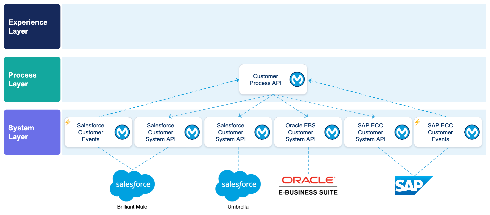
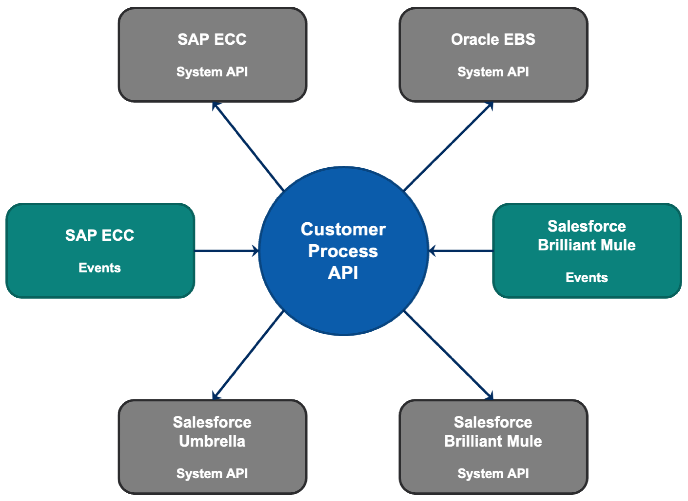

## Overview

This repository offers a Customer API-led Reference Architecture, initially developed and presented to a customer in October 2024 to demonstrate MuleSoft’s API-led connectivity based on specific requirements. In March 2026, the demo was revisited, refined through multiple iterations, and expanded in scope, ultimately resulting in this formalized Reference Architecture.

The Customer API-led Reference Architecture demonstrates API design, structure, and standardization using an API-led connectivity approach. It currently highlights three complementary concepts:

- A comprehensive API-led connectivity implementation for customer data across systems.
- Event-driven integration using Salesforce Change Data Capture (CDC) in Mule.
- Automation commands that can be used to implement CI/CD pipelines.

The Customer API-led Reference Architecture is composed of the following reusable assets:

- System APIs that align with the underlying systems.
- A Process API that orchestrates and transforms data using a canonical model.
- Integration components that support event-driven integration patterns.
- Reusable RAML fragments that standardize data models, response structures, behavior, and security.
- Utility scripts that support development, synchronization, publication, and maintenance workflows.

This repository serves as both a working implementation and a set of platform standards for reuse across projects. It provides an **opinionated approach to API-led connectivity**, informed by practical customer experience and established enterprise integration patterns. The conventions, structures, and standards here are designed to promote consistency, reuse, and maintainability across API portfolios.

> [!NOTE]
> The historical context, goals, and scope of the initial baseline are documented in [`docs/releases/release-1-baseline.md`](docs/releases/release-1-baseline.md).

## Architecture Diagram

The diagram below depicts the Customer API-led Reference Architecture, highlighting the relationships between the Customer Process API, System APIs, and event-driven integrations.

The diagram illustrates how the Customer Process API serves as the central integration point, invoking System APIs and receiving customer data changes from event-driven integrations.

## Architecture

This implementation follows an API-led connectivity model composed of three layers:

- **System APIs** provide access to underlying systems using system-aligned models.
- **Process APIs** orchestrate data across systems and transform it into a canonical model.
- **Experience APIs** consume canonical data and tailor it for specific consumers, but they are intentionally omitted from this implementation because this reference architecture focuses on system integration and canonical data orchestration rather than consumer-specific experiences.

Event-driven integration components complement these API layers by processing changes originating from external systems and delivering them to the appropriate APIs. These components may use formal specifications such as AsyncAPI when appropriate.

### Key Principles

- **System-aligned data models** -- System APIs reflect the structure and constraints of the underlying system.
- **Canonical data model** -- Defined once and used by Process APIs to enable cross-system consistency.
- **Separation of concerns** -- Each layer has a clearly defined responsibility.
- **Reuse through fragments** -- Common patterns are centralized and reused across APIs.

## Source of Truth

This repository is the authoritative source of truth for all assets that comprise the Customer API-led Reference Architecture, including:

- API specifications and RAML fragments
- Mule application implementations
- Documentation describing the architecture, standards, and supporting workflows
- Anypoint Exchange metadata and dependency definitions

Assets published to Anypoint Platform, including Design Center projects and Anypoint Exchange assets, are considered generated artifacts derived from this repository and are maintained solely to support demonstrations, experimentation, and validation activities.

As a result:

- Changes are always made in Git first.
- Design Center projects are synchronized from this repository through automation.
- Anypoint Exchange assets are published from the repository, either through synchronized Design Center projects or directly, depending on the asset type.
- Drift between Git and Anypoint Platform assets is periodically detected and corrected in favor of the repository state.

This repository therefore follows a Git-centric workflow where source control, rather than the Anypoint Platform, is the authoritative system of record.

## Repository Structure

- `apis/` -- API assets that comprise the reference architecture.
- `assets/` -- Images used throughout repository documentation.
- `docs/` -- Additional repository documentation, release notes, and technical guidance.
- `integrations/` -- Event-driven integration components.
- `libraries/` -- Shared RAML fragments used throughout the reference architecture.
- `scripts/` -- Utility scripts supporting development and synchronization workflows.
- `standards/` -- Standards, principles, and implementation guidance.

Refer to the README file within each folder for additional details.

## Architecture Summary

1. System APIs expose system-specific data using system-aligned models.
2. Process APIs orchestrate across systems and transform data into a canonical model.
3. Event-driven integration components process changes originating from external systems, transform data as needed, and deliver it to the appropriate APIs.
4. Shared fragments enforce consistency across:
   - Data models
   - Response structure
   - Response behavior
   - Security
5. Utility scripts support development, synchronization, publication, and maintenance workflows.

Together, these components provide:

- A consistent API design standard.
- A reusable set of building blocks.
- A repeatable approach to API development and publication.

## Implementation Scope

This repository demonstrates API-led architecture patterns, event-driven integration, reusable RAML fragments, and Mule implementations for the APIs and integration components included in the reference architecture.

Standardized implementations for logging, monitoring, and enterprise error handling are not included. MuleSoft Professional Services typically provides reusable patterns for these capabilities in customer engagements. These assets are intentionally excluded from this reference architecture.

## Intended Audience

This repository is intended for:

- API designers.
- Integration architects.
- MuleSoft developers.
- Platform engineers defining enterprise API standards.

## Versioning

Semantic versioning is applied at the asset level within this repository. Version 1.0.0 represents the initial standardized release of the Customer API-led Reference Architecture.
