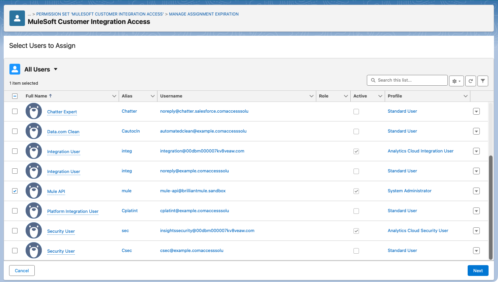
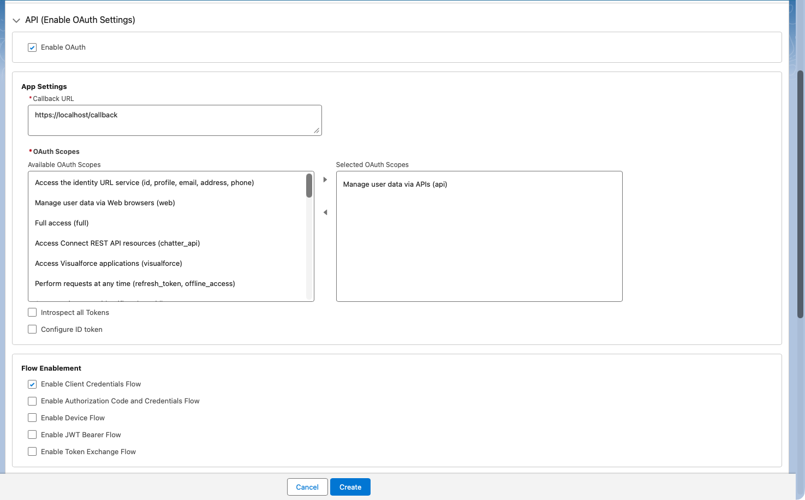
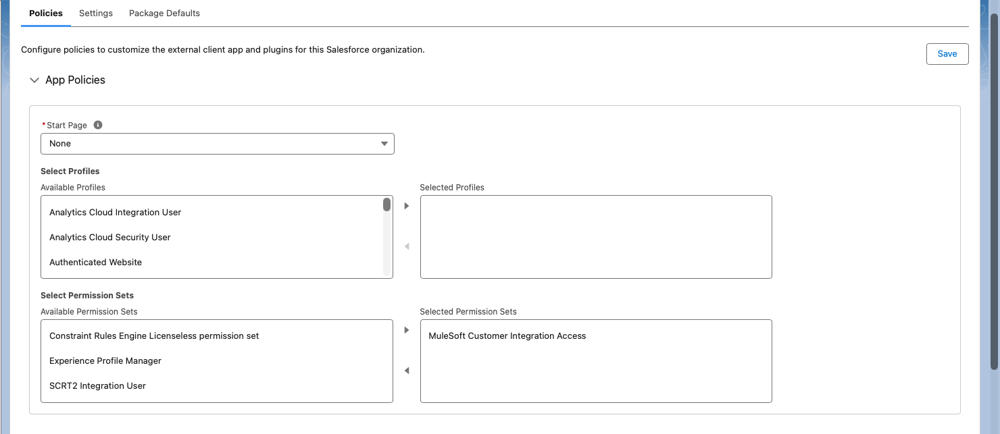
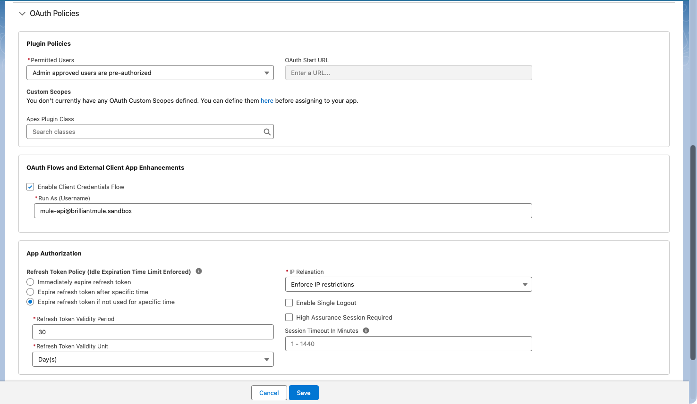
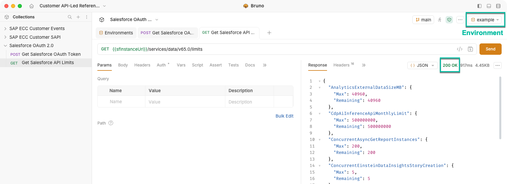

# Salesforce OAuth 2.0 Client Credentials

This document presents a high-level overview of the process for configuring OAuth 2.0 Client Credentials in Salesforce for integration with MuleSoft. It was authored in the context of the Customer API-led Reference Architecture, and the configuration herein is derived from that work.

## Prerequisites

Before beginning, ensure that the following requirements are met:

- System Administrator access to the Salesforce instance.
- An existing Salesforce user for MuleSoft integrations.

## Security Considerations

The process outlined in this document utilizes a user account assigned the System Administrator profile. Access tokens inherit the Salesforce permissions associated with this user, which may result in broad administrative access. This setup is designed for demonstration and reference architecture scenarios. For production environments, adhere to the principle of least privilege by using a dedicated integration user with only the necessary permissions.

## Configuration Steps

### Step 1 — Create and Assign a Permission Set

1. Sign in to Salesforce using a system administrator account.
2. Click the gear icon and select **Setup**.
3. In the Quick Find search box, enter **Permission Sets**.
4. Open **Permission Sets**.
5. Click **New**.
6. Configure the new permission set as follows:

   - **Label:** Enter a meaningful name for the permission set - e.g., `MuleSoft Customer Integration Access`.
   - **API Name:** Accept the generated value.
   - **License:** None

7. Click **Save**.

8. On the newly created permission set’s page, click **Manage Assignments**.

9. Click **Add Assignments**.

10. Select the existing Salesforce user for MuleSoft integrations.

11. Click **Next**, then **Assign**.

### Step 2 — Create an External Client App

1. In the Quick Find search box, enter **External Client App Manager**.
2. Open **External Client App Manager**.
3. Click **New External Client App**.
4. Configure the **Basic Information** section as follows:

    - **External Client App Name:** Enter a meaningful name representing the Mule API or integration - e.g., `MuleSoft Customer Integration`.
    - **API Name:** Accept the generated value.
    - **Contact Email:** Enter your email address.
    - **Distribution State:** Accept the default value - i.e., `local`.

5. Expand the **API (Enable OAuth Settings)** section, and select **Enable OAuth**.

6. Configure the **API (Enable OAuth Settings)** section as follows:

    - **App Settings**
        - **Callback URL:** Enter a callback URL as it is required but it is not used in the client credentials flow - e.g., `https://localhost/callback`.
    - **OAuth Scopes**
        - **Selected OAuth Scopes:** `Manage user data via APIs (api)`.
    - **Flow Enablement**
        - Select **Enable Client Credentials Flow**.

7. Click **Create**.

Do not leave this page as the next step resumes from this point.

### Step 3 — Configure OAuth Policies

1. On the **Policies** tab, click **Edit**.

2. Expand the **OAuth Policies** section.

3. Change **Permitted Users** to `Admin approved users are pre-authorized` under **Plugin Policies**. This reveals additional configuration options.

4. Configure the **App Policies** section as follows:
   - **Start Page:** None
   - **Select Profiles:** No selected profiles.
   - **Select Permission Sets:** Select the permission set created earlier - e.g., `MuleSoft Customer Integration Access`.

5. Configure the **OAuth Policies** section as follows:

   - Under **OAuth Flows and External Client App Enhancements**:
     - Select **Enable Client Credentials Flow**.
     - **Run As (Username)**: Enter the existing Salesforce user for MuleSoft integrations.

6. Click **Save**.

Do not leave this page as the next step resumes from this point.

### Step 4 — Retrieve OAuth Credentials

1. Select the **Settings** tab, and expand the **OAuth Settings** section.
2. Click **Consumer Key and Secret**.
3. Copy the **Consumer Key** and **Consumer Secret** and store them in a safe location.

### Step 5 — Validate Authentication Using Bruno

1. Open the [workspace](/bruno-workspace) in Bruno and select the Salesforce OAuth 2.0 collection. Alternatively, open the `docs/salesforce/api-requests` directory in Bruno.

2. Update the provided environment (i.e., `example`) or create a new one, and configure the following variables:

   | Name           | Value                                                   |
   | -------------- | ------------------------------------------------------- |
   | sfLoginUrl     | Salesforce Domain URL used for OAuth authentication     |
   | sfClientId     | Consumer Key from the Salesforce External Client App    |
   | sfClientSecret | Consumer Secret from the Salesforce External Client App |

3. Select the configured environment in Bruno.

4. Execute **Get Salesforce OAuth Token** and verify that Salesforce returns HTTP `200 OK`. The request automatically stores the access token and Salesforce instance URL in the runtime variables `sfAccessToken` and `sfInstanceUrl`.

5. Execute **Get Salesforce API Limits** and verify that Salesforce returns HTTP `200 OK`, confirming successful authentication and API access.

## Conclusion

With the Salesforce External Client App configured and OAuth authentication successfully validated using Bruno, the Salesforce environment is ready for integration with MuleSoft using the OAuth 2.0 Client Credentials flow.
